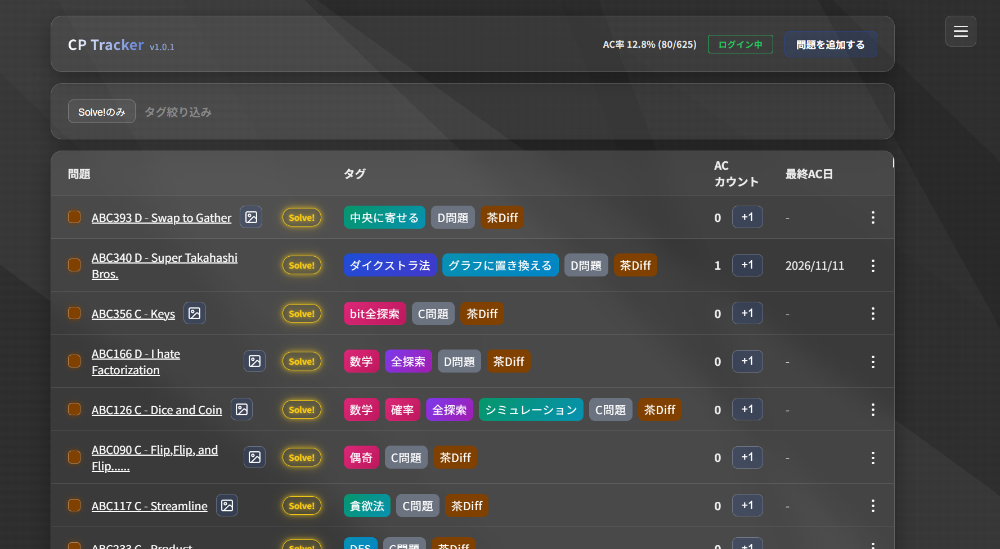
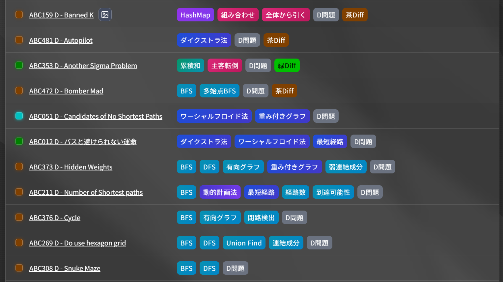
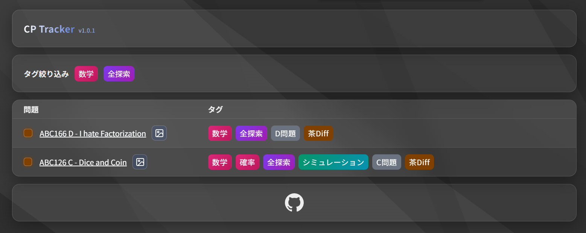
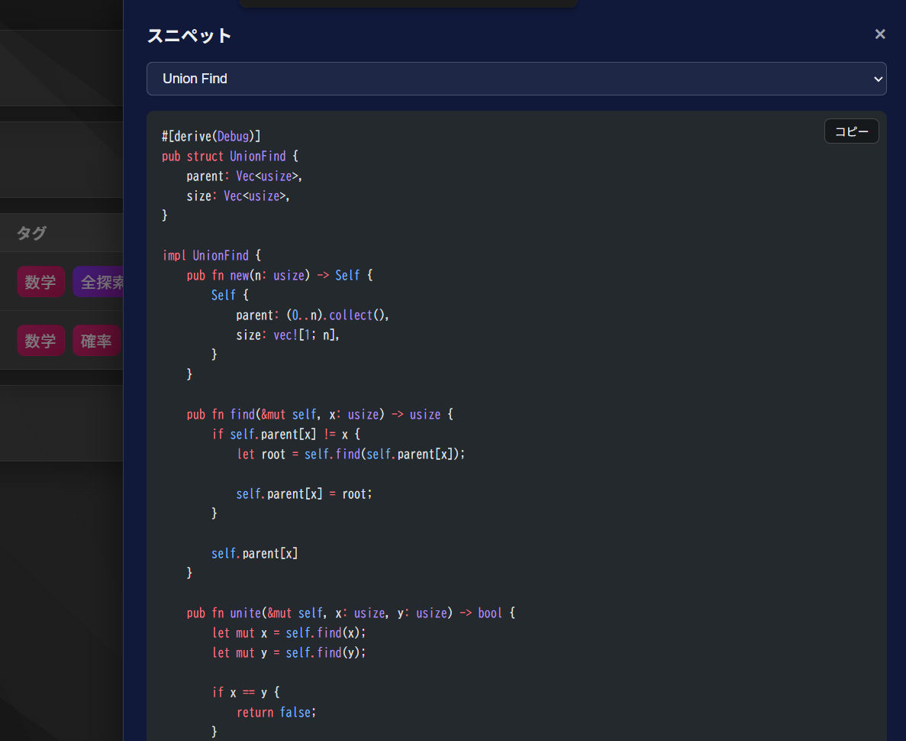
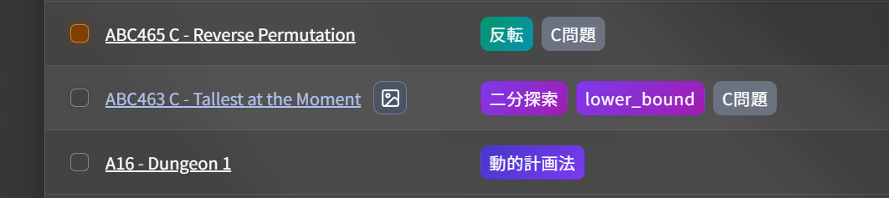
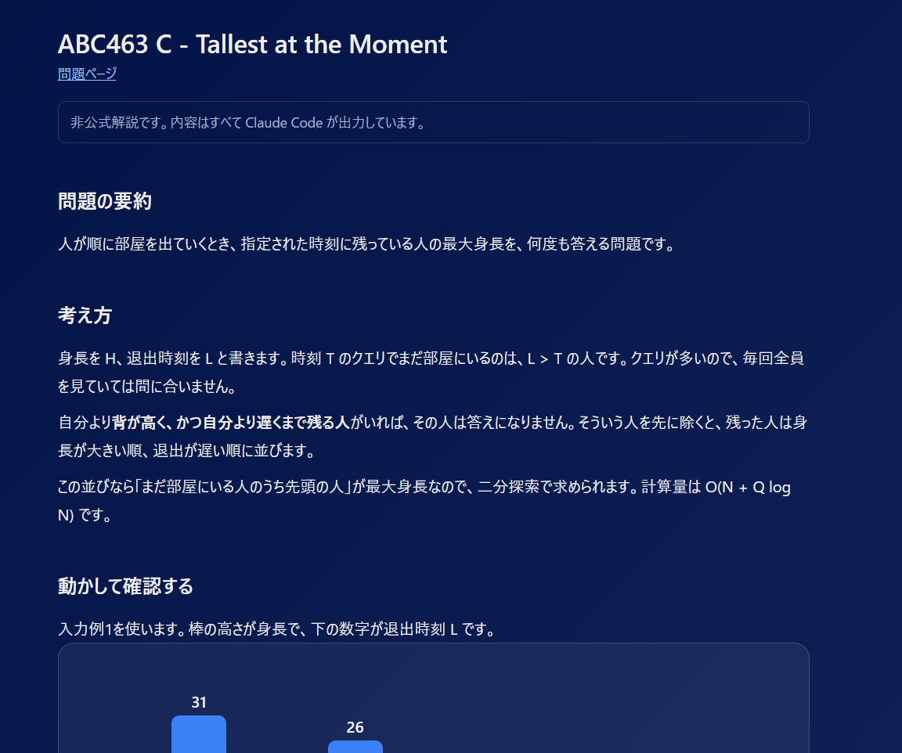
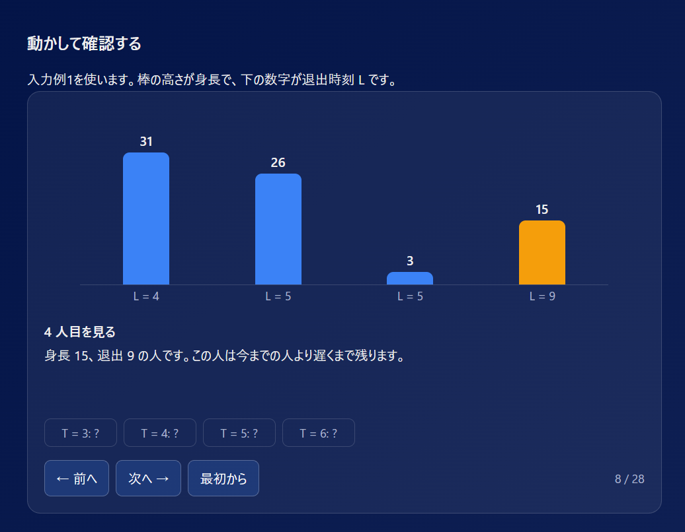

# CP Tracker

競技プログラミング精進記録用アプリケーション。

今のことろ自分専用。ログイン機能は作ってある。

[バックエンドリポジトリ](https://github.com/kento-yoshidu/cp_tracker_backend)

## 機能

### 共有機能

### 難易度の表示

問題タイトルの左に、AtCoderのDifficultyに応じた色のマークを表示する。

### タグの表示と絞り込み

問題に設定されているタグを表示する。

タグをクリックすると、そのタグで問題を絞り込める。複数タグでのAND絞り込みが可能。

### スニペット

右上のメニューからスニペットをコピーできる。

### 解説ページ

問題によっては解説ページを用意している。問題タイトル横のアイコンから遷移できる。

解説は100% Claude Codeが生成していて、人間の手は一切入っていない。

ほとんどのページには「動かして確認する」が用意されており、シミュレーションを見ながら解き方を理解できる。

## 機能(ログイン時のみ)

### ACカウントと最終AC日

問題ごとにACカウントを記録。最終AC日も記録。

### バッヂの表示

最終AC日から一定期間を経過するとSolve!バッヂが表示される。表示条件は以下の通り。

|AC数|最終日からの経過日数|
|---|---|
|0|0日（常に表示）|
|1|3日|
|2|7日|
|3|30日|
|4|60日|

5回ACすると完全に理解したとみなし、Doneバッジを表示する。継続してACはできる。

### 編集

### 削除

### アーカイブ

### AC履歴
